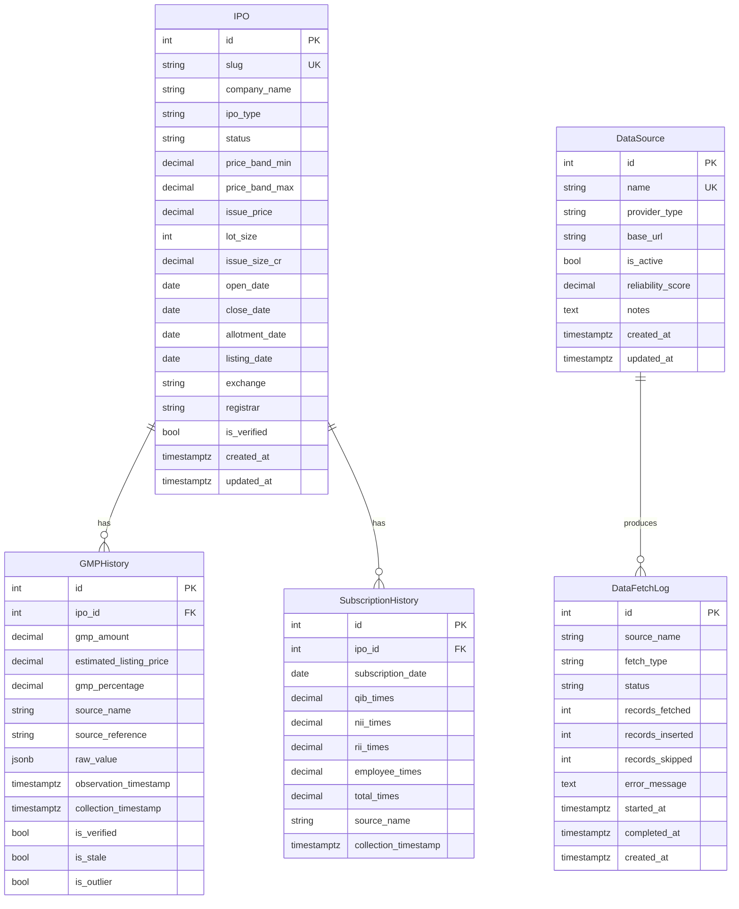

# Database Schema — IPO Intelligence Platform

## Overview

The database consists of **five core tables** backed by PostgreSQL 16. All tables use `SERIAL` / `BIGSERIAL` integer primary keys. Timestamps are stored as `TIMESTAMP WITH TIME ZONE` in **UTC**. Enumerations use PostgreSQL native `ENUM` types for data integrity.

---

## ER Diagram



---

## Table Definitions

### `ipo`

The central fact table. Each row represents one IPO.

| Column | Type | Nullable | Description |
|--------|------|----------|-------------|
| `id` | `SERIAL` | No | Primary key |
| `slug` | `VARCHAR(255)` | No | URL-safe unique identifier (e.g. `bajaj-housing-finance-ipo`) |
| `company_name` | `VARCHAR(500)` | No | Official company name as per SEBI filing |
| `ipo_type` | `ipo_type_enum` | No | `MAINBOARD` or `SME` |
| `status` | `ipo_status_enum` | No | `UPCOMING`, `OPEN`, `CLOSED`, `ALLOTTED`, `LISTED` |
| `price_band_min` | `NUMERIC(12,2)` | Yes | Lower end of price band (₹) |
| `price_band_max` | `NUMERIC(12,2)` | Yes | Upper end of price band / offer price (₹) |
| `issue_price` | `NUMERIC(12,2)` | Yes | Final issue price (set after book building) |
| `lot_size` | `INTEGER` | Yes | Minimum application lot size (number of shares) |
| `issue_size_cr` | `NUMERIC(14,2)` | Yes | Total issue size in crore rupees |
| `open_date` | `DATE` | Yes | IPO subscription opening date (IST) |
| `close_date` | `DATE` | Yes | IPO subscription closing date (IST) |
| `allotment_date` | `DATE` | Yes | Expected allotment date (IST) |
| `listing_date` | `DATE` | Yes | Expected / actual listing date (IST) |
| `exchange` | `VARCHAR(10)` | Yes | `NSE`, `BSE`, or `NSE,BSE` |
| `registrar` | `VARCHAR(255)` | Yes | Registrar & transfer agent name |
| `is_verified` | `BOOLEAN` | No | True if key fields have been cross-checked with official sources |
| `created_at` | `TIMESTAMPTZ` | No | Row creation time (UTC, server-set) |
| `updated_at` | `TIMESTAMPTZ` | No | Last modification time (UTC, auto-updated) |

**Indexes:**
- `UNIQUE (slug)`
- `INDEX (status)`
- `INDEX (listing_date)`
- `INDEX (open_date, close_date)`

---

### `gmp_history`

Append-only table. **Rows are never updated or deleted.** Each row is one GMP observation from one source at one point in time.

| Column | Type | Nullable | Description |
|--------|------|----------|-------------|
| `id` | `BIGSERIAL` | No | Primary key |
| `ipo_id` | `INTEGER` | No | FK → `ipo.id` |
| `gmp_amount` | `NUMERIC(10,2)` | No | GMP in rupees (may be negative) |
| `estimated_listing_price` | `NUMERIC(12,2)` | Yes | `issue_price + gmp_amount` at collection time |
| `gmp_percentage` | `NUMERIC(8,4)` | Yes | `(gmp_amount / issue_price) * 100` |
| `source_name` | `VARCHAR(100)` | No | Identifying name of the data source |
| `source_reference` | `VARCHAR(500)` | Yes | URL or document reference |
| `raw_value` | `JSONB` | Yes | Original payload from the provider (for auditing) |
| `observation_timestamp` | `TIMESTAMPTZ` | No | When the GMP was observed (as reported by source) |
| `collection_timestamp` | `TIMESTAMPTZ` | No | When our pipeline fetched the data (UTC) |
| `is_verified` | `BOOLEAN` | No | Manually verified by admin (default false) |
| `is_stale` | `BOOLEAN` | No | True if observation is older than the staleness threshold |
| `is_outlier` | `BOOLEAN` | No | True if flagged as a statistical outlier |

**Indexes:**
- `INDEX (ipo_id, observation_timestamp DESC)` — primary query pattern
- `INDEX (source_name, collection_timestamp)`
- `UNIQUE (ipo_id, source_name, observation_timestamp)` — deduplication guard

---

### `subscription_history`

One row per IPO per day of subscription data, per source.

| Column | Type | Nullable | Description |
|--------|------|----------|-------------|
| `id` | `BIGSERIAL` | No | Primary key |
| `ipo_id` | `INTEGER` | No | FK → `ipo.id` |
| `subscription_date` | `DATE` | No | Date of subscription data (IST) |
| `qib_times` | `NUMERIC(10,2)` | Yes | QIB category subscription (times) |
| `nii_times` | `NUMERIC(10,2)` | Yes | NII/HNI category subscription (times) |
| `rii_times` | `NUMERIC(10,2)` | Yes | RII/Retail category subscription (times) |
| `employee_times` | `NUMERIC(10,2)` | Yes | Employee category subscription (times) |
| `total_times` | `NUMERIC(10,2)` | Yes | Overall subscription (times) |
| `source_name` | `VARCHAR(100)` | No | Identifying name of the data source |
| `collection_timestamp` | `TIMESTAMPTZ` | No | When the pipeline fetched the data (UTC) |

**Indexes:**
- `UNIQUE (ipo_id, subscription_date, source_name)` — prevents duplicate rows for the same day
- `INDEX (ipo_id, subscription_date DESC)`

---

### `data_source`

Registry of configured data providers.

| Column | Type | Nullable | Description |
|--------|------|----------|-------------|
| `id` | `SERIAL` | No | Primary key |
| `name` | `VARCHAR(100)` | No | Unique identifier used in `source_name` FK-by-name pattern |
| `provider_type` | `VARCHAR(50)` | No | `NSE`, `BSE`, `OFFICIAL_FILING`, `GMP_COMMUNITY`, `MANUAL` |
| `base_url` | `VARCHAR(500)` | Yes | Base URL of the provider |
| `is_active` | `BOOLEAN` | No | Whether the pipeline should use this source |
| `reliability_score` | `NUMERIC(3,2)` | Yes | 0.00–1.00 subjective reliability weight |
| `notes` | `TEXT` | Yes | Free-text notes (terms of use status, limitations) |
| `created_at` | `TIMESTAMPTZ` | No | Row creation time (UTC) |
| `updated_at` | `TIMESTAMPTZ` | No | Last modification time (UTC) |

**Indexes:**
- `UNIQUE (name)`

---

### `data_fetch_log`

Audit log for every pipeline run. Rows are append-only.

| Column | Type | Nullable | Description |
|--------|------|----------|-------------|
| `id` | `BIGSERIAL` | No | Primary key |
| `source_name` | `VARCHAR(100)` | No | Provider name |
| `fetch_type` | `VARCHAR(50)` | No | `IPO_LIST`, `GMP`, `SUBSCRIPTION`, `ALLOTMENT` |
| `status` | `fetch_status_enum` | No | `STARTED`, `SUCCESS`, `PARTIAL`, `FAILED` |
| `records_fetched` | `INTEGER` | Yes | Total records received from the source |
| `records_inserted` | `INTEGER` | Yes | Records written to the database |
| `records_skipped` | `INTEGER` | Yes | Records skipped (duplicates or validation failures) |
| `error_message` | `TEXT` | Yes | Full error traceback if `status = FAILED` |
| `started_at` | `TIMESTAMPTZ` | No | Pipeline run start time (UTC) |
| `completed_at` | `TIMESTAMPTZ` | Yes | Pipeline run end time (UTC, null if still running) |
| `created_at` | `TIMESTAMPTZ` | No | Row creation time (UTC) |

**Indexes:**
- `INDEX (source_name, started_at DESC)`
- `INDEX (status, started_at DESC)` — quickly find recent failures

---

## Enum Types

```sql
CREATE TYPE ipo_type_enum AS ENUM ('MAINBOARD', 'SME');

CREATE TYPE ipo_status_enum AS ENUM (
    'UPCOMING',
    'OPEN',
    'CLOSED',
    'ALLOTTED',
    'LISTED'
);

CREATE TYPE fetch_status_enum AS ENUM (
    'STARTED',
    'SUCCESS',
    'PARTIAL',
    'FAILED'
);
```

---

## Key Design Decisions

### 1. UTC Internally, IST for Display
All `TIMESTAMPTZ` columns store UTC. The API returns UTC ISO 8601. The frontend converts to IST (`Asia/Kolkata`, UTC+5:30) using `Intl.DateTimeFormat`. Date-only columns (`DATE`) represent IST calendar dates as declared by exchanges/registrars.

### 2. Append-Only GMP History
GMP data is volatile and community-sourced. Overwriting historical values would destroy the audit trail and trend history. Every GMP observation gets its own row with `observation_timestamp` and `collection_timestamp`. To show the "current" GMP, the API queries `MAX(observation_timestamp)` per source.

### 3. No Soft Deletes on Core Tables
IPO and GMP rows are not soft-deleted. If erroneous data is ingested:
- For GMP: flag `is_outlier = true` or `is_stale = true`.
- For IPO: use `is_verified = false` and correct the wrong fields.
- Raw original values are preserved in `raw_value JSONB` for forensics.

### 4. Source Name as a String Foreign Key
`gmp_history.source_name` and `subscription_history.source_name` reference `data_source.name` by value (not by integer FK). This is intentional: it makes the audit log human-readable and survives `data_source` row deletions without orphaned FK errors.

### 5. JSONB for Raw Payloads
`gmp_history.raw_value` stores the original provider payload as `JSONB`. This enables:
- Re-parsing historical data if the parser logic changes.
- Debugging data quality issues without re-fetching.
- Future full-text or structural queries against raw data.

### 6. Reliability Score
`data_source.reliability_score` (0.00–1.00) allows the API to weight or prioritise GMP values from more reliable sources when aggregating across multiple providers.
